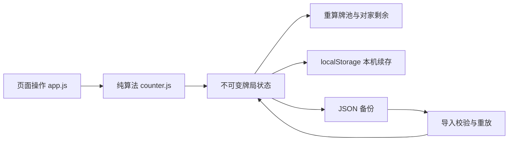

# 记牌算法与存档设计

## 运行方式

计算逻辑和本机存档在浏览器内运行，直接适配现有 GitHub Pages。当前没有远程 API 或数据库。算法模块不依赖 DOM、localStorage 或网络，也可由 Node.js 加载，便于后续接入服务端。



## 固定规则

普通牌 12 种，每种 24 张；大王、小王、鹰、3 四种牌每种 6 张，总共 `12 × 24 + 4 × 6 = 312` 张。

不推测玩家的具体手牌。全场剩余表示尚未记录为出牌的数量，不代表对家拥有这些牌。

## 唯一状态来源

```json
{
  "version": 1,
  "gameId": "牌局唯一标识",
  "startedAt": 1794787200000,
  "updatedAt": 1794787200000,
  "initialHand": null,
  "events": []
}
```

`initialHand` 为 `null` 表示未填写，为 `0` 表示确实没有牌。允许 0–312 的整数，不固定为 51。时间保存为毫秒时间戳，页面按浏览器本地时区显示。

流水只有两种：

```json
{ "id": "记录唯一标识", "kind": "table", "card": "Q", "qty": 4, "at": 1794787200000 }
```

```json
{ "id": "记录唯一标识", "kind": "opponent", "qty": 13, "at": 1794787200000 }
```

不同时保存可被修改的“已出累计”和“剩余累计”。显示数字由流水重算，避免撤销、刷新或导入后累计不同步。

## 命令和查询

| 接口 | 行为 | 必须满足 |
| --- | --- | --- |
| `createGame(initialHand)` | 创建空局 | 初始为 null 或 0–312 整数 |
| `recordTable(state, card, qty)` | 新增全场出牌 | 已知牌种、正整数、不超该牌种剩余 |
| `setInitial(state, initialHand)` | 校准对家初始值 | 不能低于已出；已有对家流水时不能置空 |
| `recordOpponent(state, qty)` | 新增对家出牌 | 初始已填写、正整数、不超对家剩余 |
| `undo(state, kind)` | 移除该组最新一笔 | 只移除选中组，保留其他流水 |
| `getStats(state)` | 查询剩余、已出与流水 | 从流水累计 |
| `serialize / deserialize` | 保存与载入 | 版本、结构、记录与累计通过校验 |
| `exportBackup / importBackup` | 跨设备备份 | 只接受本应用格式，导入前完整校验 |

命令返回新状态，已有状态及事件冻结。错误操作抛出带错误码的 `CounterError`，不会修改旧状态。无可撤销记录时返回旧状态。

## 数据关系与边界

- 每个牌种：`已出 + 剩余 = 牌种总数`，二者均为非负整数。
- 全场：`已出总数 + 剩余总数 = 312`。
- 已填写初始值的对家：`已出 + 剩余 = initialHand`。
- 全场命令不改变对家数据，对家命令不改变全场数据。
- 校准初始值后，对家流水的“记后剩余”按新初始值重算。
- 全场最多 312 笔正数记录，对家最多 312 笔，总事件上限 624。
- 拒绝重复 ID、未知牌种、未知事件类型、错误版本、非法时间、超量流水，以及超过 256 KB 的导入文件。

## 本机存储

键为 `duole-card-counter:v1`。成功操作后即时保存完整状态，载入及导入时逐笔重放检查，不相信外部文件提供的累计数。

保存失败时保留内存记录并显示导出入口。损坏存档保留原始内容，不使用空局自动覆盖；只有用户确认新局或恢复有效备份后才替换。异常原始内容也会附在导出的备份中以便排查。

页面监听同浏览器其他窗口的存档变化，提交前检查是否存在新存档。这不是数据库事务或远程多人同步；当前面向单人操作，建议同一时刻在一个窗口记牌。

## 离线与发布

Service Worker 仅处理本应用范围内的页面和固定资源。网络优先，断网时使用已缓存资源；只清理本应用前缀的旧缓存，不触及其他项目。牌局不会被发送到网络。

## 后续远程服务

如需账号、多设备实时同步或多人同时记牌，可在 Node.js 服务端复用 `counter.js`。API 层负责身份、牌局归属和权限；服务端保存状态及修订号，写入使用数据库事务或带版本条件的更新，并以事件 ID 保证重试不重复扣牌。客户端提交命令，服务端返回权威结果。当前版本没有远程同步功能。
