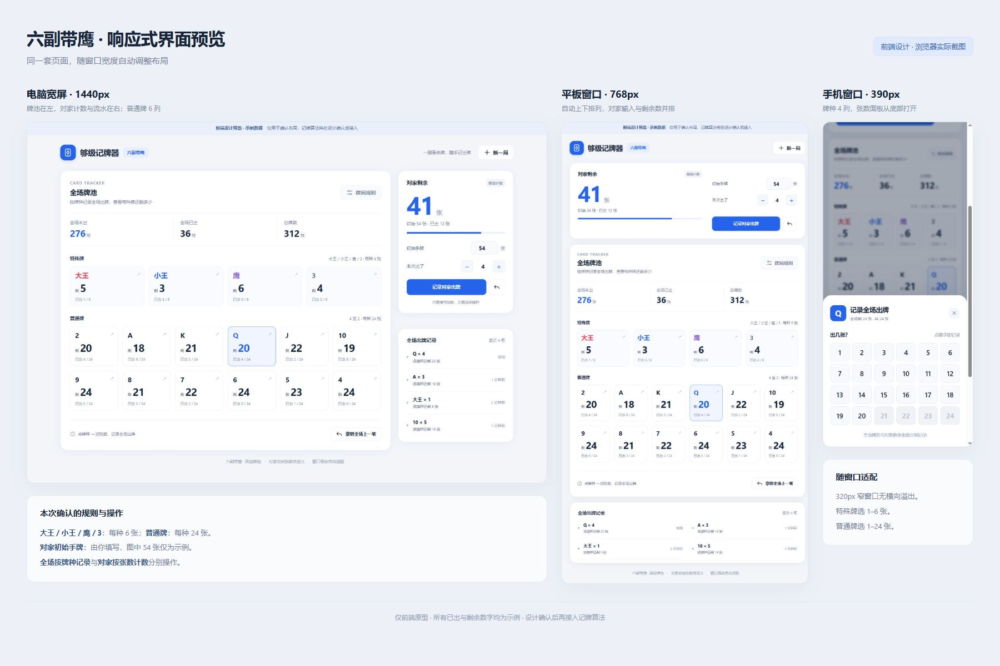

# DuoLeCard-counter · 多乐够级记牌器

web 上的记牌器，六副牌带鹰，需要手动记录。

当前版本为已确认样式的响应式前端原型。牌池、对家计数和历史记录均为示例数据，尚未实现实际记牌、撤销、存档或后端算法。



## 已确认的需求

- 只保留六副带鹰模式。
- 大王、小王、鹰、3 各 6 张。
- 4、5、6、7、8、9、10、J、Q、K、A、2 各 24 张，共 312 张。
- 按牌种记录全场出牌，显示每种牌的未出数量及已出数量。
- 对家独立按张数计数，初始手牌由用户填写，不固定为 51 张。
- 全场牌池和对家张数独立操作，无需指定全场每笔出牌属于哪位玩家。
- 前端样式已完成确认，本次上传为界面原型，记牌算法和数据结构另行实现。

## 响应式布局

- 1200px 及以上：全场牌池在左；对家计数和最近记录在右；普通牌为 6 列。
- 900–1199px：保留双栏，普通牌收紧为 4 列。
- 600–899px：单栏；对家计数卡内部为左右分区；普通牌为 6 列。
- 320–599px：单栏；对家计数在上，牌池在下；牌种为 4 列；全场撤销固定在底部。
- 数量面板：宽屏使用居中对话框；手机使用底部面板。特殊牌显示 1–6，普通牌显示 1–24。
- 使用弹性宽度、Grid、媒体查询和安全区域间距；不依赖固定设备型号。

## 预览

可直接用浏览器打开 `index.html`，或在本目录执行：

```powershell
python -m http.server 8765 --bind 127.0.0.1
```

浏览器访问 `http://127.0.0.1:8765` 后拖动窗口改变宽度。

可预览：牌种选择、数量面板、规则查看、初始手牌输入及出牌张数加减。记录、新局和撤销按钮仅展示预览提示，示例记录不会被修改。

## 浏览器检查

- 检查窗口宽度：1440、1024、768、390、320px；均无横向溢出。
- 1440px：普通牌 6 列，牌池和对家计数分列。
- 1024px：普通牌 4 列，保留双栏。
- 768px：上下布局，对家计数卡内部横向排布。
- 390px、320px：普通牌 4 列，手机底部撤销栏可见。
- 普通牌数量面板有 24 个按钮；示例 Q 剩余 20 张，对应禁用 21–24。
- 特殊牌数量面板有 6 个按钮。
- 自定义初始手牌输入可以填写 62，验证后恢复为示例值 54。
- JavaScript 语法检查通过；本地 HTTP 预览返回 200。

实际页面截图位于 `screenshots/`；`responsive-review.html` 将宽屏、平板和手机效果并排展示。
